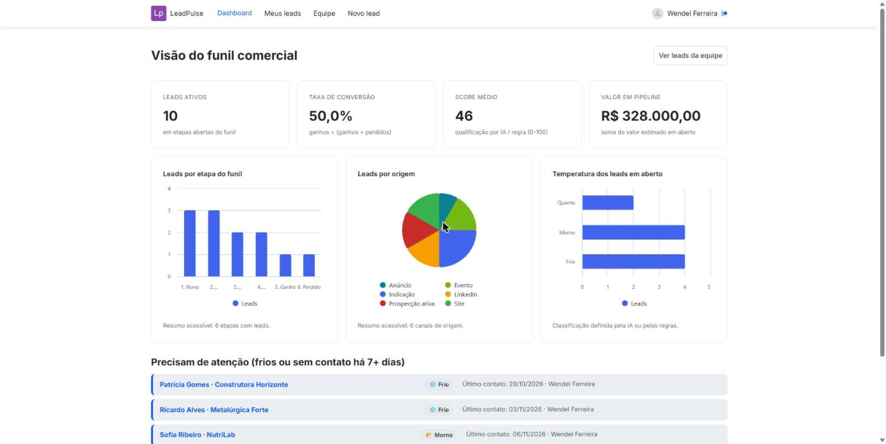
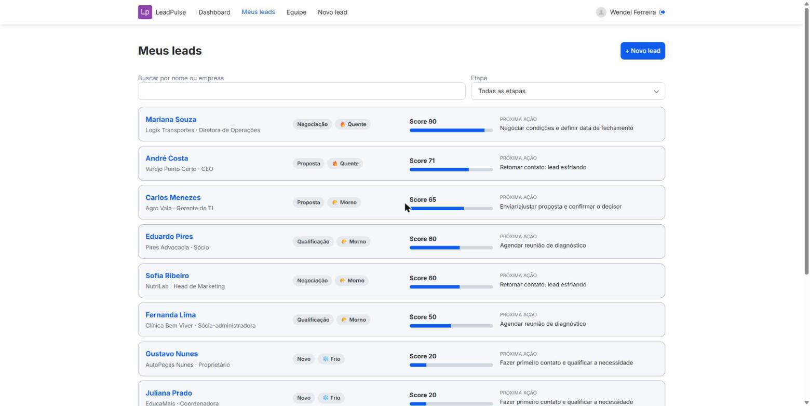
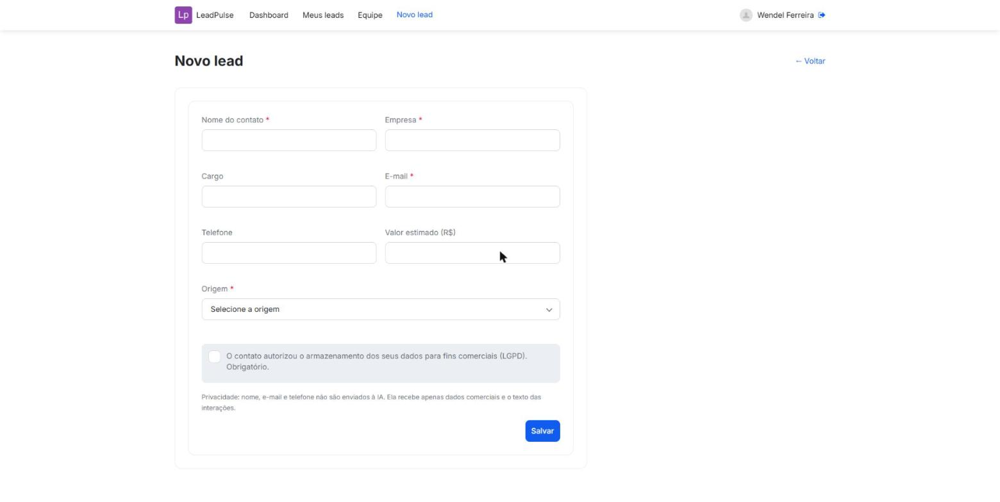
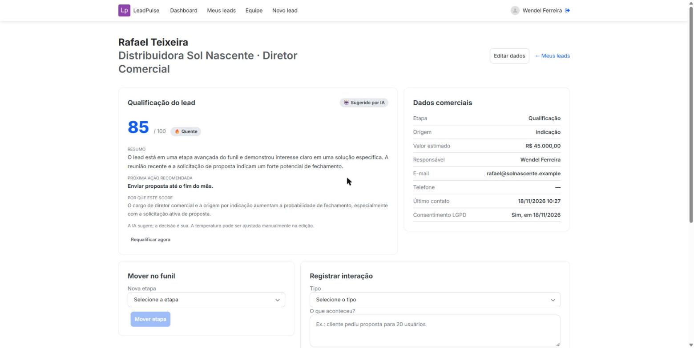
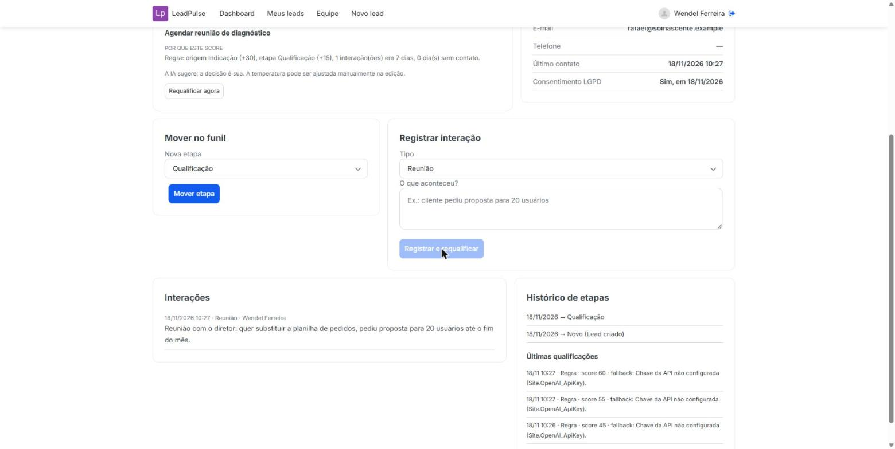

# LeadPulse: gestão de leads com OutSystems e IA

Aplicação web low-code (OutSystems 11, Reactive Web) que substitui a planilha comercial por um funil centralizado, com score e próxima ação sugeridos por IA, follow-up automático e dashboard para o gestor.

- **Aplicação:** https://personal-rpbtnzk7.outsystemscloud.com/LeadPulse
- **Vídeo pitch:** https://youtu.be/2dEy6hi5ky0
- **Parte teórica:** [docs/parte-teorica.md](docs/parte-teorica.md)
- **Como a IA funciona:** [docs/ia-prompt-e-regras.md](docs/ia-prompt-e-regras.md)

---

## 1. O problema
Os leads ficavam espalhados entre planilha, WhatsApp e a memória dos vendedores. O resultado eram contatos esquecidos, prioridade por intuição, duplicidades, nenhum controle de consentimento (LGPD) e um gestor sem visão do funil.

## 2. Funcionalidades
| Tela | O que faz |
|---|---|
| **Meus leads** (inicial) | Lista os leads do usuário ordenados por score, com busca por nome ou empresa, filtro por etapa, temperatura (ícone + texto), barra de score e próxima ação. |
| **Cadastro** | Valida campos e e-mail, bloqueia **e-mail duplicado** e exige **consentimento LGPD**. Avisa que dados pessoais não vão para a IA. |
| **Detalhe do lead** | Card de qualificação (score, temperatura, resumo, próxima ação, justificativa e selo IA/Regra/Manual), mover no funil, registrar interação, histórico de interações e de etapas, e log das últimas qualificações. |
| **Dashboard** (Gestor) | KPIs: leads ativos, taxa de conversão, score médio e valor em pipeline. Gráficos por etapa, origem e temperatura, e a lista "precisam de atenção". |
| **Equipe** (Gestor) | Todos os leads da equipe, com o responsável de cada um. |
| **Automação** | Timer diário que esfria leads parados há 7+ dias e timer diário que anonimiza leads perdidos há mais de 12 meses. |

## 3. Arquitetura (Canvas)
| Camada | Módulo | Responsabilidade |
|---|---|---|
| Interface | `LeadPulse` (Reactive Web) | 5 telas, menu, validações de UX, navegação |
| Core | `LeadPulse_CS` (Service) | Entidades e static entities, regras de negócio (RN01–RN09), qualificação por IA com fallback, timers, roles `Gestor`/`Vendedor` |
| Foundation | `OpenAI_IS` (Service) | Consume REST da API de Chat Completions (JSON mode), DTOs, Site Properties `OpenAI_ApiKey` (secreta) e `OpenAI_Modelo` |
| Foundation (Forge) | OutSystems UI · OutSystems Charts | Padrões de tela (Card, layout) e gráficos (Column, Pie, Bar) |

As referências só descem de camada. As entidades são *read-only* para a interface, e toda escrita passa pelas Server Actions do Core.

## 4. Tecnologias
- **OutSystems 11**, Reactive Web App, Service Modules, Timers, Site Properties, Roles
- **Forge:** OutSystems UI, OutSystems Charts
- **OpenAI API:** `gpt-4o-mini` via Consume REST API (`response_format: json_object`)

## 5. Recurso de IA e automação
1. No cadastro, numa interação nova ou numa mudança de etapa, `Lead_Qualificar` monta um **contexto sem dados pessoais**: cargo, empresa, origem, etapa, valor, dias parado e as últimas 5 interações.
2. A IA devolve um JSON com `score`, `temperatura`, `resumo`, `proxima_acao` e `justificativa`, que é **validado** antes de ser gravado.
3. Em três casos o **score por regras** assume: chave não configurada, falha da API ou resposta fora do contrato. A tela mostra a fonte: "🤖 Sugerido por IA" ou "📏 Calculado por regras".
4. Toda qualificação vai para `AnaliseIA`, com fonte, modelo, tokens e motivo do fallback.
5. Os timers fazem o follow-up automático (lead esfriando) e a retenção LGPD.

## 6. Prints
| Meus leads | Cadastro com validação LGPD |
|---|---|
|  |  |
| **Detalhe com qualificação** | **Interações, histórico e log de qualificações** |
|  |  |

## 7. Como testar
Acesse https://personal-rpbtnzk7.outsystemscloud.com/LeadPulse com o usuário `gestor.demo` (perfil Gestor, que também é Vendedor). A senha vai junto com a entrega.

Algumas coisas que dá para testar:
- Criar um lead sem marcar o consentimento LGPD: o app não deixa salvar.
- Criar um lead com o e-mail `mariana.souza@logix.example`: bloqueia porque o e-mail já existe.
- Salvar com um e-mail novo: o lead já abre com score e próxima ação.
- Mover um lead de **Novo** direto para **Proposta**: bloqueia, só avança uma etapa por vez.
- Registrar uma interação: o score é recalculado.
- Marcar como **Perdido** sem informar o motivo: bloqueia.
- **Dashboard** e **Equipe** só aparecem para o Gestor.

### Configuração do ambiente
- **Chave da IA:** Service Center → Factory → Modules → `OpenAI_IS` → Site Properties → `OpenAI_ApiKey`. Sem a chave, o app funciona com o score por regras.
- **Usuários e roles:** app *Users* do ambiente, roles `Gestor` e `Vendedor` (módulo `LeadPulse_CS`).
- **Dados de demonstração:** com a base vazia, o Dashboard mostra o botão **Gerar dados de demonstração** (só para Gestor).

## 8. Uso responsável
- Dados enviados à IA minimizados.
- Consentimento LGPD obrigatório e anonimização automática.
- A IA sugere e a pessoa decide, com justificativa visível.
- Chave fora do código.
- Autorização validada no servidor.
- Temperatura indicada por ícone e texto, não só por cor.
- Gráficos com resumo textual.

